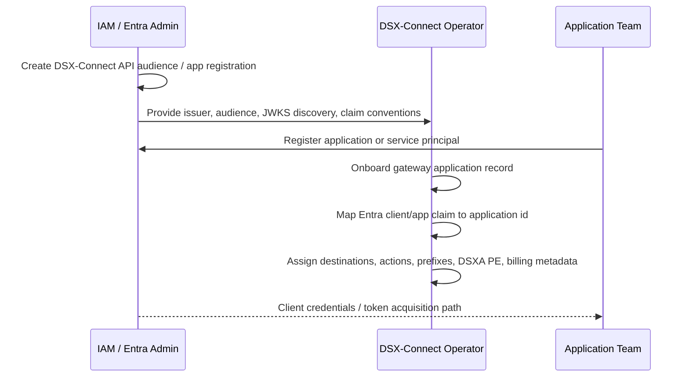
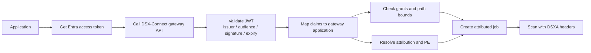
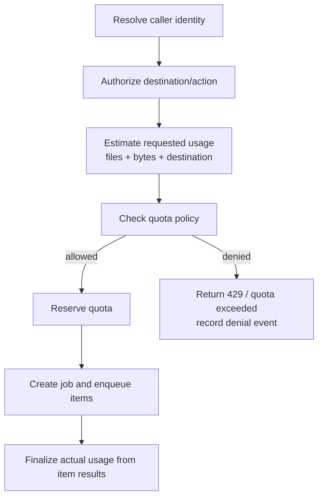

# DSX-Connect 2 Quotas And Entra Call Prep - 2026-08-19

This note is internal call prep for explaining the current gateway, attribution, quotas, and Entra direction.

## Positioning

DSX-Connect is moving from connector orchestration toward an enterprise file gateway.
The important shift is that applications do not call a scanner directly and do not own repository credentials, remediation policy, audit, or chargeback metadata.

The working model is:

```text
Application
    -> DSX-Connect gateway API
    -> gateway application identity
    -> destination and action grants
    -> attributed scan job
    -> scan worker
    -> DSXA protected entity + X-Custom-Metadata
    -> durable result and usage record
```

The truthful message for the call:

```text
This is early-stage implementation, but the core enforcement path is real.
The current lab uses static bearer tokens as a stand-in for Entra-issued tokens.
Those tokens already resolve to application identity, destination grants, DSXA protected entity binding,
and tenant/application/cost-center attribution that follows each file into DSXA metadata and DSX-Connect results.
```

## What Works Today

- Operator console has an `Applications` surface for onboarding gateway callers.
- Gateway application records include application id, display name, enabled state, identity bindings, DSXA protected entity id, tenant/customer/business metadata, cost center, billing code, and destination grants.
- The file gateway API resolves a bearer token to a gateway application record.
- `GET /api/v1/files/destinations` is filtered by the caller's `discover` grants.
- `POST /api/v1/files/transfers` enforces destination `submit` grants and optional path prefixes.
- Submissions can be destination-backed transfers or destination-less scan-only submissions.
- Job and item payloads persist attribution context.
- Scan worker passes DSXA protected entity id and rich `X-Custom-Metadata`.
- `GET /api/v1/execution/jobs/{job_id}/dsxa` returns a job-shaped DSXA projection with common attribution at job level and file-specific details per item.

## What Is Stubbed

### Static Bearer Instead Of Entra

The current resolver is:

```text
Authorization: Bearer demo-gateway-token
    -> DSX-Connect gateway application record
    -> grants + attribution + protected entity binding
```

Production Entra integration should replace only the identity-validation part:

```text
Authorization: Bearer Entra JWT
    -> validate issuer, audience, signature, expiry, and claims
    -> map appid / azp / client_id / sub to DSX-Connect gateway application record
    -> grants + attribution + protected entity binding
```

This keeps DSX-Connect responsible for file gateway authorization and governance instead of trying to make Entra the full policy engine.

### Quotas Are Designed, Not Enforced

The implementation already captures the dimensions needed for quota and metering:

- principal id
- application id
- tenant/customer ids
- cost center and billing code
- file count
- file size bytes
- job id and transfer id
- destination id and platform
- DSXA verdict details
- job timing and throughput

The missing enforcement slice is a quota service that checks and reserves usage before job creation, then finalizes usage from completed job items.

## Entra Story

DSX-Connect should integrate with Entra using standard OAuth2/OIDC patterns.

Platform onboarding:



Runtime:



Key talking point:

```text
Entra proves who is calling.
DSX-Connect decides what that caller can do with files, where files may go, which policy applies, and what attribution is recorded.
```

## Quota Story

Quotas belong at the gateway boundary, before job creation.

Example controls:

- maximum files per day per application
- maximum bytes per month per tenant/customer
- maximum concurrent jobs per application
- burst submission rate per token or principal
- destination-specific limits for sensitive repositories

Conceptual flow:



The likely first implementation should be intentionally small:

```text
quota key: application_id
limits: files_per_day, bytes_per_day, concurrent_jobs
decision point: POST /files/transfers and future POST /files/scans
response: structured 429 with quota category and retry/reset information
```

## Demo Script

1. Open the DSX-Connect operator console.
2. Show `Applications`.
3. Open the demo application and point out:
   - static bearer token
   - DSXA protected entity id
   - allowed destinations
   - tenant/customer/application/cost-center/billing metadata
4. Open the Developer MVP.
5. Use `demo-gateway-token`.
6. Refresh destinations and show that destinations are resolved through gateway authorization.
7. Submit one or more files.
8. Open the job/result JSON and show:
   - job id
   - attribution at job level
   - per-file verdicts
   - file hashes and sizes
   - DSXA `x_custom_metadata`
9. Explain that Entra will replace the static token resolver, not the gateway governance model.
10. Explain that quotas will be enforced at the same API boundary where the request is already authenticated, authorized, attributed, and counted.

## Demo Curl Examples

List allowed destinations:

```bash
curl -sS http://dsx-connect.10.2.4.103.nip.io/api/v1/files/destinations \
  -H 'Authorization: Bearer demo-gateway-token'
```

Submit scan-only:

```bash
curl -sS -X POST http://dsx-connect.10.2.4.103.nip.io/api/v1/files/transfers \
  -H 'Authorization: Bearer demo-gateway-token' \
  -F 'metadata={"application":"scan-only-demo"}' \
  -F 'files=@/path/to/file'
```

Read DSXA-shaped result:

```bash
curl -sS http://dsx-connect.10.2.4.103.nip.io/api/v1/execution/jobs/JOB_ID/dsxa
```

## Do Not Overstate

Avoid saying:

- Entra production integration is complete.
- Quota enforcement is complete.
- DSX-Connect replaces enterprise IAM.
- DSX-Connect replaces MFT for large-scale bulk movement.

Say instead:

- The gateway path already resolves caller identity, grants, protected entity binding, and attribution.
- Static bearer is an intentionally simple identity adapter for demo and local development.
- Entra is the next production identity adapter.
- Quotas are the next enforcement policy on the same already-working gateway boundary.
- The architecture keeps IAM, repository access, DSXA attribution, and DSX-Connect governance cleanly separated.

## Next Engineering Slices

1. Add quota policy fields to gateway application records.
2. Add usage counters/reservations keyed by application id and time window.
3. Enforce quota checks in `POST /files/transfers`.
4. Add structured quota-denial responses and audit records.
5. Add OIDC issuer configuration.
6. Add JWKS fetch/cache and JWT validation.
7. Add claim-to-application mapping.
8. Add operator-console fields for Entra issuer, audience, and application claim mapping.
9. Add tests for invalid token, disabled app, missing grant, quota exceeded, and successful attributed submission.
