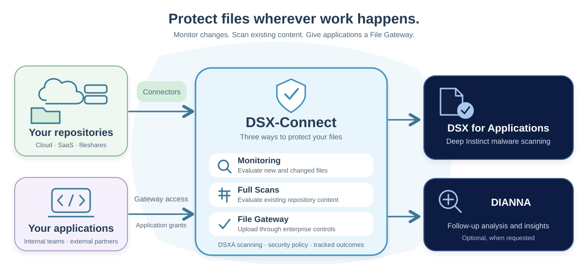

# Homepage Illustration Concept

A simpler view of DSX-Connect, with repository protection and application uploads sharing an enterprise-controlled file workflow.

[Open the illustration at full size](assets/diagrams/homepage-concept.svg).

The lower row emphasizes the operational boundaries: IT / DevOps manages repository access, Security owns file-handling policy, and developers use the governed API.
